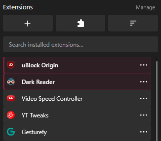

# Zolf Mods Extensions List

A [Sine](https://github.com/CosmoCreeper/Sine) mod that turns Zen's extensions panel into a clean, searchable, sortable list with real extension names.

## Features

- **Vertical list** with the real name of every extension (both of Zen's extension groups), identical tiles for every type.
- **Search** installed extensions – matches jump to the top, the rest is dimmed.
- **Pin to Top** and **Hide** from the extension's three-dots menu. Hidden extensions fold away under a small chevron that expands them with an animation.
- **Custom order by drag & drop** – grab the handle that appears next to the three dots; the rows move live while you drag.
- **Sorting** (name A–Z / Z–A, date added, most used, recently used). Pinned, regular and hidden extensions are sorted as three separate lists; only extensions that are in the list are affected, not the ones pinned to the browser toolbar.
- **Action bar**: add extensions (opens Firefox Add-ons, or a menu with alternative stores), extension settings (`about:addons`) and sort.
- Tidied three-dots menu (Pin to Toolbar → Pin to Top → Hide, no doubled separators).
- Wider panel, list height snapped to whole rows, no bottom fade, no hover bounce, Zen's top buttons restyled to match.
- Texts follow the browser language (Polish or English); the labels in Sine's settings are bilingual because Sine can't localise them.

## Settings

Open the mod's settings in Sine:

| Option | Description |
| --- | --- |
| Show alternative stores in the + button menu | When enabled, the **+** button opens a menu with Firefox Add-ons and your own links. When disabled it opens Firefox Add-ons directly. |
| Alternative store links | `Name\|URL; Name\|URL; …` – edit, remove or add links. Only `http(s)://` and `about:` URLs are accepted. Default: `Zen Mods\|https://zen-browser.app/mods/; Sine Mods\|https://sineorg.github.io/store/`. |

Everything else (pinned, hidden, custom order, sort mode, usage counters) is stored in preferences under `extensions.list.sine.*`.

> "Most used" and "recently used" count clicks on an extension's main button **inside this panel**, starting from the moment the mod is installed.

## Requirements

- Zen Browser
- Sine, with **Allow installing JS from unofficial sources** enabled

JavaScript mods run in the browser's privileged UI context. Install this mod only if you trust its source and have reviewed its code.

## Installation

1. Extract the ZIP.
2. In Zen open **Settings → Sine Mods** and enable installing JS from unofficial sources.
3. Install the mod with Sine's local/import option (or put the folder in Sine's mods directory), then restart Zen.
4. Open the extensions panel.

## Project files

- `theme.json` – Sine metadata and script registration.
- `preferences.json` – the mod's settings (alternative stores).
- `extensions-list.uc.js` – privileged browser script (names, pin/hide, drag & drop, sorting, search, menus).
- `userChrome.css` – layout and styling.
- `preview.png` – screenshot used above.
- `CHANGELOG.md` – version history.
